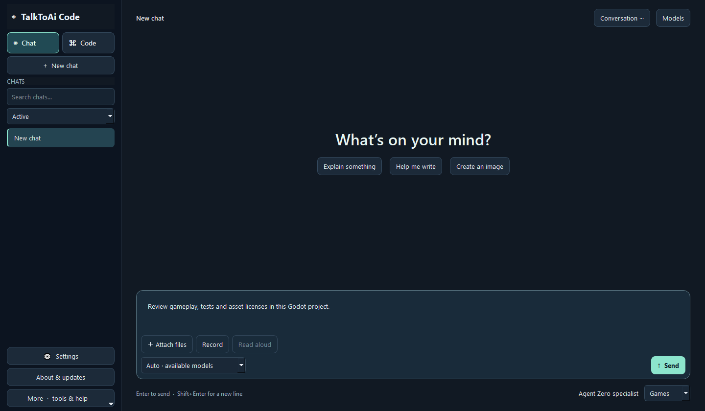

# TalkToAi Code

**Local AI for everyday work and projects.** Chat or dictate a message, ask Agent Zero to compare products or check sources, and use specialist help for code, games, writing, or local creative work. Local Ollama chat needs no subscription or API key.

[**Download the latest release**](https://github.com/ResearchForumOnline/TalkToAi-Code/releases/latest) · [Microsoft Store](https://apps.microsoft.com/detail/9PPGFB30SHD9) · [What's new](docs/DESKTOP-9.0.4.md) · [Get help](https://github.com/ResearchForumOnline/TalkToAi-Code/issues)

## Install

| System | Get TalkToAi Code |
| --- | --- |
| **Windows** | [Windows x64 setup](https://github.com/ResearchForumOnline/TalkToAi-Code/releases/download/v9.0.4/TalkToAi-Code-9.0.4-Windows-Setup.exe) or the [Microsoft Store](https://apps.microsoft.com/detail/9PPGFB30SHD9). The Store listing follows Microsoft's rollout. |
| **macOS** | [Download the macOS kit](https://github.com/ResearchForumOnline/TalkToAi-Code/releases/download/v9.0.4/TalkToAi-Code-9.0.4-macOS.tar.gz). Extract it, run `bash install-macos.sh` in the extracted folder, then open **TalkToAi Code** in your home Applications folder. |
| **Linux** | [Download the Linux kit](https://github.com/ResearchForumOnline/TalkToAi-Code/releases/download/v9.0.4/TalkToAi-Code-9.0.4-Linux.tar.gz). Extract it, run `bash install-linux.sh` in the extracted folder, then open **TalkToAi Code** from your app menu. |

The macOS and Linux kits install for your account and require Python 3.10 or later. First setup downloads the app dependencies. For local answers, install [Ollama](https://ollama.com/download) if you do not have it. TalkToAi reuses installed models and can set up Ollama on Windows. Choose **Models → Recommended → Install OpenZero 1.7B** to get started with about 1.1 GB of weights. If Qwen3.6 35B A3B already appears under **Installed Ollama**, select it without downloading again.

## Start with an example

| What you want | Try in TalkToAi |
| --- | --- |
| **Write or learn** | In Chat, ask “Explain this PDF in plain English.” Attach the PDF, then continue with a follow-up. |
| **Compare options** | Ask “Find a 2 TB SSD under £100 and compare delivery and returns.” Auto selects Shopping to check public seller pages and bring back links. |
| **Talk and listen** | In Chat, use **Record** to dictate and review your message before sending. Use **Read aloud** to listen to a reply. [Voice setup by platform](docs/DESKTOP-9.0.2.md#voice-in-chat) |
| **Check a project with multiple agents** | In Code, say “Use three agents to review the implementation, tests and README.” Agent Zero gathers separate read-only reports and brings the findings back into the task. |
| **Work in a browser or Windows app** | In Code, ask “Open my Brave browser and find the Privacy settings.” Inspect and control supported windows using Windows PC Pilot or an available browser session. |
| **Build a game or scene** | Open a Godot or Unity project, import a Kenney pack under **Game assets**, or ask Agent Zero to run a Blender script from the project. |
| **Make local replies quicker** | Type **`/tune`** to measure a cold and warm reply before adjusting how long Ollama keeps the model in memory. The default is now one hour. |
| **Create an image or video** | Say “Create an image of a lighthouse at blue hour.” Chat can run a compatible local ComfyUI setup and shows the file when it finishes. |

## Learn more

- [Inkling 2 Mini setup, reuse and model deletion](docs/DESKTOP-9.0.4.md)
- [Agent Zero specialists and automatic project teams](docs/DESKTOP-9.0.3.md)
- [Voice, automatic tools and local media setup](docs/DESKTOP-9.0.2.md)
- [Browser, Blender, Godot, Unity and optional integrations](docs/DESKTOP-8.8.0.md)
- [Local models, provider keys and free-only routing](docs/FREE-API-ROUTING.md)
- [Project instructions and reversible source improvement](docs/CUSTOMIZE-AND-IMPROVE.md)
- [Research and protocol evidence](docs/DESKTOP-9.0.0.md#research)
- [Earlier features, screenshots and release history](docs/archive/README-8.9.0.md)

[Source downloads and SHA-256 checksums](https://github.com/ResearchForumOnline/TalkToAi-Code/releases/latest) · [MIT license](LICENSE)
