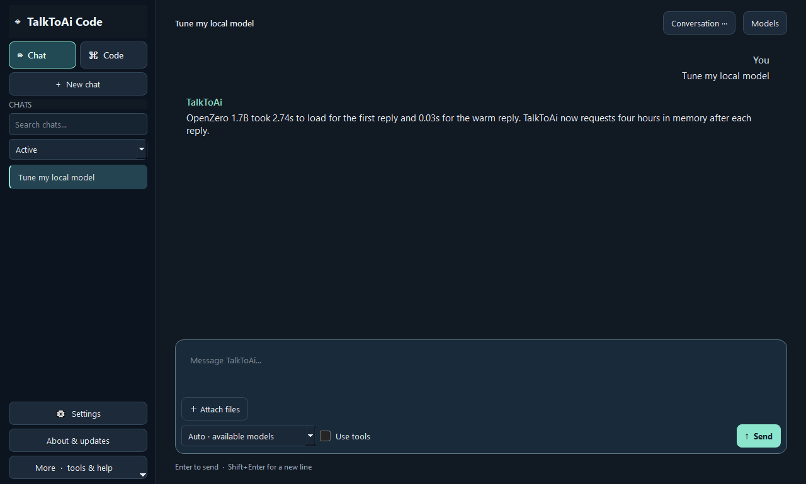

# TalkToAi Code 9.0.0

## Keep your local model ready

TalkToAi asks Ollama to keep the model in memory for one hour after a local reply. Change **Settings → Keep local Ollama models in memory** to a shorter or longer time. Ollama can also evict a loaded model under memory pressure or when another request needs its resources. During Chat, TalkToAi can reuse the model's loaded context if it fits the request and your selected memory ceiling. This can avoid reloading the same weights when moving from Code back to Chat.

**Models → Installed Ollama** shows which downloaded models are in memory. **Release from memory** frees the selected model's RAM or VRAM. You can still use its weights on disk. The inventory refreshes while the app is open. After confirmation that an old model is missing, the picker drops that model name. If Ollama is temporarily unreachable, the app retains the last known inventory.

## Tune local retention

Type `/tune` or “Tune my local model” in Chat or Code. You can also choose **Models → Tune local model**. Start before your selected model has entered memory. TalkToAi tests the same installed weights with two short local replies, times Ollama's loading step, and checks the arithmetic answer and context in both. If loading took at least one second longer and twice as long on the first reply, TalkToAi sets a four-hour retention preference. **Stop** cancels the test. **More → Local model performance → Undo last tuning change** or `/tune undo` restores the earlier setting if it still applies.

The longer period starts on the next generation. Large models keep a large allocation between requests. You can choose an explicit retention period in Settings or free the selected model's memory in Models. The preferences tool in Code can also adjust allowed defaults and read or roll back the recorded changes. Running source improvement against a project is available separately in [Skynet Mode](CUSTOMIZE-AND-IMPROVE.md).

## Ask for local project reviewers

In Code, try “Use three agents to review this implementation, its tests and its README.” **Automatic project reviewers** in Settings sets a maximum from zero to three. Agent Zero can also recognize a review with distinct implementation, test and documentation questions on its own. It puts each question in a separate context, runs the reviews one by one through the selected local Ollama model and incorporates their evidence into the parent task. Reviewers inspect the chosen project. Agent Zero remains responsible for any edits, commands and final check results. **Tools** shows the assignments and results, and **Stop** cancels the whole run.

## Browser and Windows desktop

Browser inspection returns fresh element references for supported interactive controls, including frames. Agent Zero can use those references to target a control even when several elements have similar names. It refreshes the view if the page changes and tracks pop-ups belonging to the current interaction. Windows PC Pilot accepts a unique window title and a unique control name. If accessibility cannot click a control directly, Pilot checks that the original control still covers the click point in the foreground window. [Browser, desktop and game setup](DESKTOP-8.8.0.md)

## Research

The retention test adapts a matched known-answer method from ResearchForumOnline's local serving study. Its entering, checked and applied stages use the phase and evidence rules from Zero Boundary Algebra (ZBA). The edit and undo use the existing preference audit. The app applies this staged design to one runtime preference. The result measures model loading on the current computer. [Zero Boundary Algebra 1.1](https://github.com/ResearchForumOnline/research/blob/60c343237cbf17ee3ec2969c009ec026840d618e/papers/zero-boundary-algebra-formal-specification-1.1.md) · [Local model serving-path benchmark](https://github.com/ResearchForumOnline/research/blob/60c343237cbf17ee3ec2969c009ec026840d618e/papers/local-llm-serving-path-benchmark-2026-07-26.md) · [Reversible recursive agent improvement](https://github.com/ResearchForumOnline/research/blob/60c343237cbf17ee3ec2969c009ec026840d618e/papers/reversible-recursive-agent-improvement-2026.md)

The delegation design borrows isolated context and bounded worker roles from Qwen Code and Hermes. TalkToAi runs workers serially on one local model to suit computers with limited RAM. [Qwen Code subagents](https://github.com/QwenLM/qwen-code/blob/main/docs/users/features/sub-agents.md) · [Hermes subagent delegation](https://github.com/NousResearch/hermes-agent/blob/main/website/docs/user-guide/features/delegation.md)

Browser observations use scoped element references and a selected-page workflow. [Hermes browser tools](https://github.com/NousResearch/hermes-agent/blob/main/tools/browser_tool.py) · [BrowserQwen](https://github.com/QwenLM/Qwen-Agent/blob/main/browser_qwen.md)
